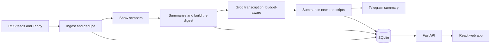

# TL;DR

A self-hosted daily digest of the podcasts and newsletters I follow. It ingests new episodes and posts, gets a transcript for each episode, summarises everything with Gemini and serves the result as a web app, with a Telegram message after every run. It runs unattended on an Oracle Cloud ARM VM, and the APIs it uses are all on free tiers.

## What it does

- **Ingests** newsletters and podcasts from RSS, using Taddy for podcast discovery and metadata. New items are deduplicated on first sight rather than by publish date, so episodes that are indexed late are not dropped.
- **Transcribes** podcasts with show-specific scrapers where a show publishes its own transcripts, falling back to the Groq Whisper API (`whisper-large-v3`). Transcription stays inside Groq's free-tier budget and carries any backlog to the next run.
- **Two tiers:** `always` sources are transcribed on every run; `on_demand` sources arrive with their show notes and can be transcribed from the web app with one click.
- **Summarises** each item with Gemini 2.5 Flash (falling back to Flash Lite) and writes a two-part feed summary: news, and informative highlights.
- **Web app:** a masonry feed, an archive, full articles and transcripts with copy to clipboard, full-text search, source management (search Taddy or validate any feed URL) and live Groq and Gemini budget meters.
- **Notifies:** a Telegram summary after each run, and an alert if nothing new has been ingested for 36 hours.

## How it works



A single FastAPI process serves both the JSON API (under `/api`) and the built React app. The pipeline is a separate command, run from cron, that writes to the same SQLite database.

## Stack

| Layer | Choice |
|---|---|
| Backend | Python 3.12, FastAPI, Uvicorn |
| Storage | SQLite, with FTS5 full-text search |
| Transcription | Groq Whisper API, plus show-specific scrapers |
| Summaries | Gemini 2.5 Flash (Flash Lite fallback) |
| Podcast metadata | Taddy GraphQL API |
| Frontend | React 18, Vite, Tailwind CSS, React Router |
| Notifications | Telegram Bot API (Twilio WhatsApp optional) |
| Hosting | Oracle Cloud Ampere VM (Ubuntu 22.04), nginx, systemd, cron |

## Repository layout

```
src/
  main.py          pipeline entry point: one run, scheduler, health check
  config/          settings (environment variables) and the sources.yaml seed list
  ingestors/       RSS, Taddy, Groq transcription and show-specific scrapers
  summariser/      Gemini prompts and calls
  storage/db.py    SQLite schema, migrations and queries
  delivery/        FastAPI app, Telegram and WhatsApp
frontend/          React app
deploy/            VM config of record: systemd unit, nginx site, crontab, firewall, deploy and backup scripts
scripts/           diagnostics, one-off maintenance and build helpers
tests/             API tests
```

## Running locally

You need Python 3.12, a current Node.js LTS release, and free API keys for Gemini, Groq and Taddy. Telegram is optional.

```bash
python -m venv venv && source venv/bin/activate      # Windows: venv\Scripts\activate
pip install -r requirements.txt

cp .env.example .env                                 # fill in the keys
python -c "import secrets; print(secrets.token_urlsafe(32))"   # use this as API_BEARER_TOKEN
cp frontend/.env.example frontend/.env.local         # set VITE_API_TOKEN to the same token

(cd frontend && npm ci && npm run build)
python -m src.main --run-now --since 12h             # one pipeline run
uvicorn src.delivery.api:app --host 127.0.0.1 --port 8000
```

Then open http://127.0.0.1:8000. The first run seeds the sources from `src/config/sources.yaml`; after that, the Sources page in the app is the source of truth. For frontend work, run `npm run dev` in `frontend/`, and Vite proxies `/api` to port 8000.

Other pipeline modes: `--daemon` runs the built-in scheduler, `--ingest-only` only ingests, and `--health-check` exits non-zero (and alerts on Telegram) if ingestion has stalled.

## Deployment

Production runs on an Oracle Cloud Ampere VM, and `deploy/` is the config of record:

- nginx on port 80 proxies to Uvicorn on `127.0.0.1:8000`, run by the `daily-digest` systemd unit.
- cron runs the pipeline at 07:00 UTC (covering the previous 12 hours) and at 10:00, 13:00, 16:00 and 20:00 UTC (4 hours each). It also runs the health check every 6 hours and takes a verified, gzipped database backup at 03:15 UTC, keeping 14 days.
- `bash deploy/deploy.sh` on the VM backs up the database, fast-forwards to `origin/main`, checks the pinned dependencies, rebuilds the frontend with the token from `.env`, swaps it in, restarts the API and verifies the result. `bash deploy/deploy.sh --rollback` restores the previous release.

## Security

- **Writes are deny-by-default.** Every request under `/api` other than GET, HEAD and OPTIONS needs `Authorization: Bearer <token>`, and if no token is configured, writes are refused. The Twilio webhook is the only exemption and checks Twilio's signature instead. `tests/test_api.py` covers this.
- **Reads are public by design.** The token is built into the frontend bundle, so it keeps out casual traffic rather than a determined visitor. Put the site behind a login if the content should be private.
- **Secrets live only in `.env`**, which is gitignored; `.env.example` lists every name.

## Tests

```bash
python -m pytest tests -q
```

## Roadmap

- Ask questions of the transcript archive: chunk and embed transcripts locally, store the vectors in the same SQLite file with sqlite-vec, then retrieve and synthesise answers with Gemini.
- A trends view across sources over time.
